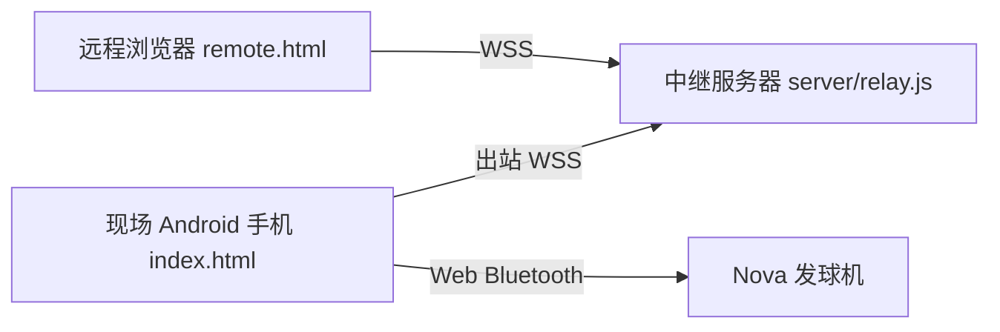

# Nova S Pro Drill Control

A pretty web client for the Nova S Pro table tennis robot. 
This tool can be used as a replacement for the original app, removing the requirements for server connectivity and user login.

| Main | Editor | Countdown |
| :---: | :---: | :---: |
|  |  |  |

## Usage

**Online/Offline:**

  * Visit: [https://wenguang1111.github.io/nova/](https://wenguang1111.github.io/nova/) (after enabling GitHub Pages and deploying).
  * Self hosting: https is required

**Local:**

  * Download repository files and host locally (e.g., `python3 -m http.server`).

**Docker:**

  * visit https://github.com/elton-bt/nova

**Requirements:**

  * Chrome, Cromite or any other Chromium-based browser. iPhone is not supported as it uses Webkit browser engine.


## GitHub Pages 部署

本仓库的控制页面地址为 **https://wenguang1111.github.io/nova/**，源码地址为 [wenguang1111/nova](https://github.com/wenguang1111/nova)。

1. 将修改提交并推送到该仓库的 `main` 分支。
2. 在 GitHub 仓库的 **Settings → Pages → Build and deployment → Source** 中选择 **GitHub Actions**。
3. 在 **Actions → Deploy GitHub Pages** 中运行工作流（或再次推送 `main`）。部署成功后访问上述页面。

`.github/workflows/pages.yml` 发布静态文件，不需要 Node 构建、账户登录或 GitHub token 写进前端。CSS/JS 使用相对路径，兼容 `/nova/` 子路径。保留原有蓝牙控制、球路编辑、随机/变体、CSV 导入导出、分享码和主题功能；`1.3/` 历史版本及独立 `converter.html` 工具保持原样。

手机控制需要 **HTTPS + 支持 Web Bluetooth 的浏览器**，推荐 Android Chrome。iPhone 的 Safari/常规 iOS Chrome 不提供本项目需要的 Web Bluetooth。电脑上的 `http://localhost` 可用于本地开发；手机访问电脑的普通 HTTP 局域网地址不满足蓝牙安全上下文要求。

## 界面语言

右上角菜单 → **语言 / Language** 可切换 **简体中文 / English**。首次按浏览器首选语言选择，之后记住手动选择。切换不刷新页面，不重置连接或球路参数。

主控制页、球路编辑器、训练提示、对话框与内置球路显示名称均支持双语。用户填写的球路名称原样保存，支持中文；存储键、蓝牙协议及 CSV 字段仍保持原格式。翻译入口是 `js/i18n.js`，编辑与运行消息分别位于 `js/locales/`。

## 手机设置保存在哪里？

点击编辑器的 **保存 / Save** 后，球路以 JSON 写入**当前手机、当前浏览器、当前网站来源的 `localStorage`**，不是手机里的独立球路文件，也不会提交到 GitHub。GitHub Pages 只提供网页文件；普通保存不调用在线分享服务，也不是把配置文件存到发球机。

| 数据 | localStorage 键 |
| :--- | :--- |
| 球路参数（包括修改后的内置球路） | `custom_drills` |
| 自定义分组中的球路名称与索引 | `custom_data` |
| 用户默认球路（原有代码接口） | `user_defaults` |
| 内置球路排列顺序 | `drill_order` |
| 累计统计、上次使用的球路 | `nova_stats`、`nova_last_played` |
| 主题、界面语言 | `nova_theme_pref`、`nova_language` |

- 关闭页面、重新打开或刷新后，通常仍能恢复；清除网站数据、恢复出厂设置、隐私模式结束或浏览器清理存储后可能丢失。主页的临时难度、次数/时长、间隔选项并非全部持久化。
- 换手机、换浏览器不会自动同步。由 `olanga.github.io` 换到 `wenguang1111.github.io` 属于不同来源，不能自动读取旧数据。同一 `https://wenguang1111.github.io` 下不同项目路径则共享同源存储，不能把路径当作隔离边界。
- **导出球路** 会下载 `nova_drills_full.csv`；具体位置由手机浏览器/系统决定，通常在“下载”中。可在旧地址导出、在新地址导入。注意：现有 CSV **不是完整备份**，不含随机顺序、启用状态、落点偏移（scatter）、统计、主题或排列元数据；自定义球路仅导出等级 1，导入时复制到三个等级。导入会替换现有自定义球路列表，操作前先导出留存。
- **分享球路** 是另一回事：主动分享会把所选球路名称、参数与随机标记上传到原有第三方服务 `https://nova.varandal.de`，生成分享码。自托管页面不等于自托管分享服务，也不提供自动云端备份。请勿在分享名称里放个人敏感信息。

## 远程控制（实验性）

远程的人在浏览器里打开 `remote.html` 发起请求；发球机旁边连着蓝牙的 Android 手机（主控端）通过**出站** WSS 连接中继服务器，在本机确认后才执行。不需要家用路由器端口映射、UPnP、局域网 VPN 或远程桌面；建议手机使用访客 Wi‑Fi / 隔离 VLAN 或移动数据。



**使用流程**

1. 现场手机连接发球机 → 菜单 → **远程控制**，填写中继地址（`wss://…/ws`），可设置本机最高电机转速、最高发球频率，点 **开启远程会话**。
2. 把生成的**一次性邀请链接**发给远程的人（邀请参数在 `#` 后，不会发送给 GitHub Pages；打开后从地址栏清除）。每个会话只允许一个控制端，30 分钟后过期。
3. 远程端选择球路、难度、次数（1–30）或时间（10–300 秒）、间隔（0.5–5 秒），点 **请求开始**。
4. 现场手机弹出确认框，30 秒内点 **允许** 才开始；超时或拒绝则丢弃。每次开始都要重新确认。

**安全约束**

- 只接受白名单结构化指令 `run_drill` / `stop`；不能发送脚本、URL 或原始蓝牙数据包。中继服务器与现场手机**都**校验参数、序号（拒绝重放/乱序）和有效期；中继服务器限制开始请求频率，`stop` 不受序号、有效期和限频阻挡。
- 只能运行现场手机已有的球路，且超过本机转速/频率上限的球路不会出现在远程列表中，也会被本机拒绝。
- 任一方断开、会话过期、现场点 **结束**、或主控页面切到后台，会话立即结束，主控端停止远程启动的训练；断线不会恢复会话，也不会重放开始指令，必须重新邀请。会话期间主控端尝试保持屏幕常亮（Screen Wake Lock）。
- 现场的停止按钮始终有效。**这不是失效安全装置**：浏览器被系统挂起、锁屏或蓝牙断开时，停止指令可能送不到发球机，发球机自身的超时行为尚未经过硬件验证。现场必须有人能随时切断电源。
- 视频请另用视频通话。

**部署中继服务器**

GitHub Pages 只托管前端，中继服务器需单独部署（Node.js ≥ 20）：

```bash
cd server
npm ci
ALLOWED_ORIGINS=https://wenguang1111.github.io PORT=8787 npm start   # 默认只监听 127.0.0.1
```

在前面放一个提供 TLS 的反向代理（如 Caddy：`relay.example.com { reverse_proxy 127.0.0.1:8787 }`），主控端填写 `wss://relay.example.com/ws`。`ALLOWED_ORIGINS` 必须是页面来源（不含路径），其他来源的连接会被拒绝。前端只接受 `wss://`，`ws://` 仅限 `localhost` 调试。会话只保存在内存中，重启服务器会结束所有会话。测试：`cd server && npm test`。


## Features

**General**

  * **Fully customizable drills** Add and remove drills and balls. Share, export and import settings.
  * **Data Persistence:** Settings and drills saved to browser local storage.
  * **Themes:** 4 options, including dark mode.
  * **Languages:** Simplified Chinese / English, with a saved language preference.
  * **Stratistics:**  accumulated counters (total balls/drills).<br>


**Drill Management**

  * **Edit & Create:** Modify pre-programmed drills or create custom ones (Groups A, B, C).
  * **Sharing:** Import/export via CSV or share online specific drills using codes.
  * **Randomization:** Randomize ball sequences or configure multiple variants of a single ball.
  * **Scatter:** Randomize drop point (DP) of a single ball. Configured DP +/- scatter value.
  * **Drag-and-Drop Management:** Easily reorder drill sequences or move drills between categories using drag-and-drop.
  * **Controls:** Set drill duration (time or repetitions), pause/stop, and countdown timers.
  * **Tap to skip:** Starting countdown timer can be skipped by tapping on it.<br>


**Editor Tools**

  * **Drill Editor:** Long-press drill button to access. Supports deletion, "save as", and testing entire sequences.
  * **Ball Editor:** Add/remove balls, adjust sequence, rename drills, and test single balls without saving.

## Custom Drills (CSV)

Drills can be imported via CSV. Each category (A, B, C) holds 100 drills; each drill holds 20 balls. Variant balls (pseudo-randomness) share the same ball number.

**CSV Format:** `Set;Ball;Name;Speed;Spin;Type;Height;Drop;BPM;Reps`

**Example:**

```csv
A;1;Drill A2;7.5;5;top;50;-5;60;1
A;2;Drill A2;7.5;5;back;50;-5;30;1
B;1;Drill B1;7.5;5;top;50;-5;60;1
B;1;Drill B1;7.5;5;back;50;5;60;1
```

## Technical Parameters

| Parameter | Description | Range | Step |
| :--- | :--- | :--- | :--- |
| **Spin type** |top/back | - | - |
| **Speed** | ball speed | 0 - 10 | 0.5 |
| **Spin** | ball spin | 0 - 10 | 0.5 |
| **Height** | Ball height | -50 (down) to 100 (up) | 1 |
| **Drop** | Drop point | -10 (right) to 10 (left) | 0.5 |
| **bpm** | balls/minute | 30 - 90 | 1 |
| **Reps** | Repetitions | 1 - 200 | 1 |


## Credits & Support

Upstream control client: [olanga/nova](https://github.com/olanga/nova). This fork retains the original control features and adds bilingual UI and GitHub Pages deployment for `wenguang1111/nova`.

Additional informations: [Wiki](https://github.com/olanga/nova/wiki/General-information)

Spinsight measurements: [Wiki](https://github.com/olanga/nova/wiki/Spinsight-measurements-with-Nova-S-Pro)

Based on findings by [smee](https://github.com/smee/nova-s-custom-drills) and plunder.

PWA version 2.3a created by [Griizly](https://griizly.github.io/nova/)

[](https://ko-fi.com/E1E21PUFEQ)


